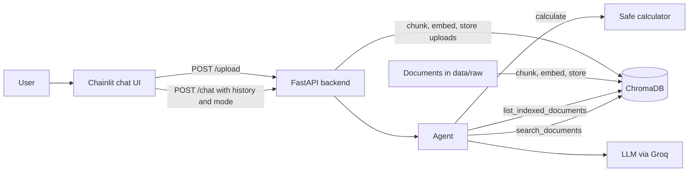

# DocuMind

A conversational assistant for company documents. You chat with it in English or Sinhala, it finds the relevant passages in the documents, and a language model answers using only those passages. Every answer shows which file it came from. If the documents don't contain the answer, it says so instead of guessing. You can also upload your own PDF or text files and ask questions about them.

I built this to learn retrieval-augmented generation (RAG) end to end: embeddings, a vector database, grounding, tool-calling agents, evaluation and testing.


## How it works



1. Documents are split into paragraph-sized chunks, converted to vectors with `all-MiniLM-L6-v2` and stored in ChromaDB.
2. The agent reads the user message and the recent conversation. For greetings and thanks it simply replies. For questions about the company it searches the documents and answers only from what it finds.
3. For arithmetic it calls a safe calculator, so "if I use 9 of my annual leave days, how many are left?" combines a document lookup with a calculation.
4. If the documents do not contain the answer, it says so.

A plain RAG pipeline without tools or memory is also exposed at `POST /ask`, and it is what the evaluation compares the agent against.

## Two answer modes

The chat has a switch (the settings icon next to the message box):

- **Answer general questions too** (on by default): questions about the company or an uploaded file are answered only from the documents. Other questions, such as "what is RAG?", are answered from the model's own knowledge and end with a note saying so.
- **Off:** DocuMind answers only from the documents and says "I don't know" otherwise. The evaluation runs in this mode.

Company facts are never guessed. If the documents don't contain them, the assistant says so in both modes.

## What you can ask

The sample company documents cover HR policy, IT security, benefits, the code of conduct, onboarding and customer support. Try greeting it, asking about leave or insurance, asking a follow-up such as "and for sick leave?", asking in Sinhala, or asking what it can help with.

## Using your own documents

Click the paperclip in the chat, attach a PDF or `.txt` file (up to 10 MB), wait for the "ready" message, then ask a question. Uploaded files are stored in `data/uploads/` and kept in the index. Scanned PDFs (images of text) are not supported because there is no OCR.

## Run it

Requires Python 3.11 and a free [Groq](https://console.groq.com) API key.

```bash
python -m venv venv
venv\Scripts\activate
pip install -r requirements.txt
```

Copy `.env.example` to `.env` and put your key in it. Then start everything with one command:

```bash
python start.py
```

The first run builds the search index, then your browser opens the chat. The script picks free ports automatically and prints the addresses (usually `http://localhost:8001` for the chat and `http://127.0.0.1:8000/docs` for the API documentation). These addresses only work on the computer where the app is running, which is why they are not clickable links here.

To run the parts separately instead:

```bash
python -m src.documind.ingestion.indexer        # build the vector index
uvicorn src.documind.api.main:app --reload       # terminal 1: backend
chainlit run app/chat.py --port 8001             # terminal 2: chat UI
```

## Project structure

```text
src/documind/
  config.py        settings
  embeddings/      text to vectors
  ingestion/       loading PDF and text files, chunking, indexing
  retrieval/       finding relevant chunks
  llm/             Groq client
  rag/             prompt and plain RAG pipeline
  agent/           tools, prompts and the agent loop
  api/             FastAPI app
app/               Chainlit chat UI
data/raw/          sample company documents
eval/              test questions and evaluation script
tests/             pytest unit tests
learning/          small experiments, one per concept
public/            logo and UI theme
scripts/           logo generator
start.py           starts the API and the UI together
```

## Evaluation

`eval/evaluate.py` runs a set of test questions through both the plain RAG pipeline and the agent (documents-only mode) and reports retrieval accuracy, answer accuracy and how often out-of-scope questions are refused. The question sets live in `eval/`:

- `test_set.json`: 20 questions about the HR and IT documents (15 answerable, 5 out of scope)
- `test_set_new.json`: questions about the benefits, onboarding and support documents
- `test_set_hard.json`: reworded, misspelled, Sinhala and out-of-scope questions, including a prompt-injection attempt

```bash
python -m eval.evaluate                      # default set
python -m eval.evaluate test_set_hard.json   # any other set
```

| Test set | Retrieval hit@1 | RAG pipeline accuracy | Agent accuracy | Refusal of out-of-scope

## Author

Thamindu Kavinda | Undergraduate data science student