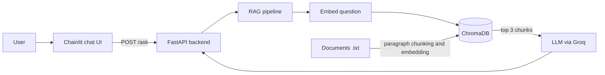

# DocuMind

A question-answering assistant for company documents. You ask a question in plain English, DocuMind finds the relevant passages in the HR and IT policy files, and a language model answers using only those passages. Every answer shows which file it came from. If the documents don't contain the answer, it says so instead of guessing.

I built this to learn retrieval-augmented generation (RAG) end to end: embeddings, a vector database, grounding, tool-calling agents, evaluation and testing.

## How it works



1. Documents are split into paragraph-sized chunks, converted to vectors with `all-MiniLM-L6-v2` and stored in ChromaDB.
2. A question is embedded the same way, and the three closest chunks are retrieved.
3. Those chunks go to the language model with an instruction to answer only from them, or say it doesn't know.

There is also a tool-calling agent (`src/documind/agent`) that can search the documents and do arithmetic, for questions like "if I use 9 of my annual leave days, how many do I have left?".

## Project structure

```text
src/documind/
  config.py        settings
  embeddings/      text to vectors
  ingestion/       chunking and indexing
  retrieval/       finding relevant chunks
  llm/             Groq client
  rag/             prompt and RAG pipeline
  agent/           tools and the agent loop
  api/             FastAPI app
app/               Chainlit chat UI
eval/              test questions and evaluation script
tests/             pytest unit tests
learning/          small experiments, one per concept
```

## Run it

Requires Python 3.11 and a free [Groq](https://console.groq.com) API key.

```bash
python -m venv venv
venv\Scripts\activate
pip install -r requirements.txt
```

Copy `.env.example` to `.env` and put your key in it. Then:

```bash
python -m src.documind.ingestion.indexer        # build the vector index
uvicorn src.documind.api.main:app --reload       # terminal 1: backend
chainlit run app/chat.py --port 8001             # terminal 2: chat UI
```

Open http://localhost:8001. API docs are at http://127.0.0.1:8000/docs.

## Evaluation

`eval/evaluate.py` runs 20 test questions (15 answerable, 5 not covered by the documents) through both the RAG pipeline and the agent.

| Metric | Result |
|---|---|
| Retrieval hit@1 / hit@3 | 100% / 100% |
| Answer accuracy, RAG pipeline | 100% |
| Answer accuracy, agent | 100% |
| Refusal of out-of-scope questions | 100% |

These numbers come from a small test set and only two short documents, so they show the system works, not that it is production-ready. Two things I found along the way:

- Splitting every 300 characters mixed several policies into one chunk and pushed the right chunk down to rank 2. Splitting by paragraph fixed it.
- The first evaluation reported 80% because the model sometimes returns non-breaking spaces and my keyword check didn't handle them. The answers were correct, so I fixed the checker.

## Tests

```bash
python -m pytest -v
```

12 unit tests cover the calculator (including rejecting arbitrary code), the chunking and the API.

## Limitations

- Only `.txt` files in `data/raw/` are indexed, and there is no upload from the UI yet.
- The chat has no memory, so each question is answered on its own.
- Evaluation uses keyword matching on a small question set. A larger set and an LLM-based judge would be the next step.

## Built with

Python, sentence-transformers, ChromaDB, Groq, FastAPI, Chainlit, pytest.

## Author

Thamindu Kavinda Dinujaya | Undergraduate Data Science Student