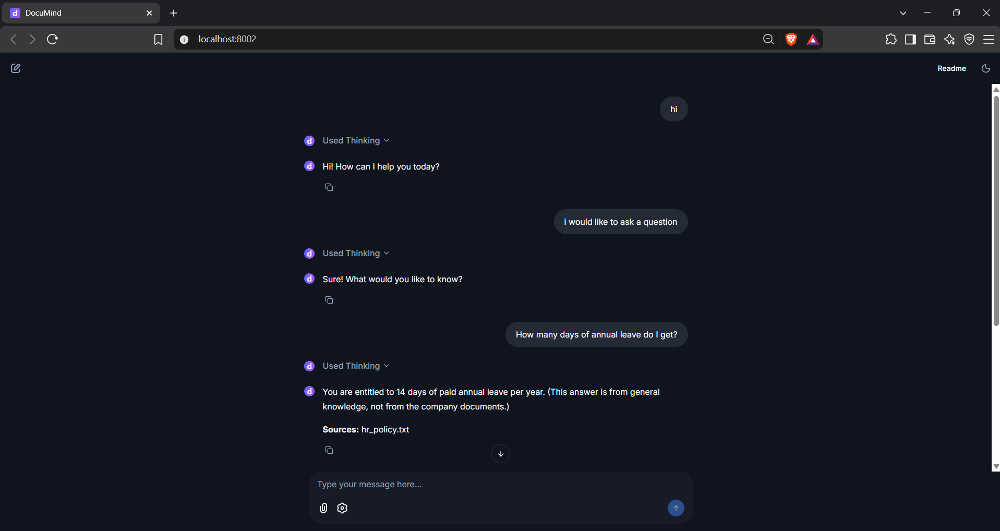
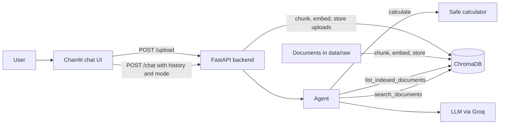

# DocuMind

A conversational assistant for company documents. You chat with it in English, Sinhala or Singlish, it finds the relevant passages in the documents, and a language model answers using only those passages. Every answer shows which file it came from. If the documents don't contain the answer, it says so instead of guessing. You can also upload your own PDF or text files and ask questions about them.

I built this to learn retrieval-augmented generation (RAG) end to end: embeddings, a vector database, grounding, tool-calling agents, evaluation and testing.



## How it works



1. Documents are split into paragraph-sized chunks, converted to vectors with `all-MiniLM-L6-v2` and stored in ChromaDB.
2. The agent reads the user message and the recent conversation. For greetings and thanks it simply replies. For questions about the company it searches the documents (turning Sinhala or Singlish into a short English query first) and answers only from what it finds.
3. For arithmetic it calls a safe calculator, so "if I use 9 of my annual leave days, how many are left?" combines a document lookup with a calculation.
4. If the documents do not contain the answer, it says so.

A plain RAG pipeline without tools or memory is also exposed at `POST /ask`. It is the baseline the evaluation compares the agent against.

## Two answer modes

The chat has a switch (the settings icon next to the message box):

- **Answer general questions too** (on by default): questions about the company or an uploaded file are answered only from the documents. Other questions, such as "what is RAG?", are answered from the model's own knowledge and end with a note saying so.
- **Off:** DocuMind answers only from the documents and says "I don't know" otherwise. The evaluation runs in this mode.

Company facts are never guessed. If the documents don't contain them, the assistant says so in both modes.

## What you can ask

The sample company documents cover HR policy, IT security, benefits, the code of conduct, onboarding and customer support. Try greeting it, asking about leave or insurance, asking a follow-up such as "and for sick leave?", asking in Sinhala, or asking what it can help with.

## Using your own documents

Click the paperclip in the chat, attach a PDF or `.txt` file (up to 10 MB), wait for the "ready" message, then ask a question. Uploaded files are stored in `data/uploads/` and kept in the index. Scanned PDFs (images of text) are not supported because there is no OCR.

## Run it

Requires Python 3.11 and a free [Groq](https://console.groq.com) API key.

```bash
python -m venv venv
venv\Scripts\activate
pip install -r requirements.txt
```

Copy `.env.example` to `.env` and put your key in it. Then start everything with one command:

```bash
python start.py
```

The first run builds the search index, then your browser opens the chat. The script picks free ports automatically and prints the addresses (usually `http://localhost:8001` for the chat and `http://127.0.0.1:8000/docs` for the API documentation). These addresses only work on the computer where the app is running, which is why they are not clickable links here.

To run the parts separately instead:

```bash
python -m src.documind.ingestion.indexer        # build the vector index
uvicorn src.documind.api.main:app --reload       # terminal 1: backend
chainlit run app/chat.py --port 8001             # terminal 2: chat UI
```

## Project structure

```text
src/documind/
  config.py        settings
  embeddings/      text to vectors
  ingestion/       loading PDF and text files, chunking, indexing
  retrieval/       finding relevant chunks
  llm/             Groq client
  rag/             prompt and plain RAG pipeline
  agent/           tools, prompts and the agent loop
  api/             FastAPI app
app/               Chainlit chat UI
data/raw/          sample company documents
eval/              question sets, results and the evaluation script
tests/             pytest unit tests
learning/          small experiments, one per concept, and a retrieval debug script
public/            logo and UI theme
scripts/           logo generator
start.py           starts the API and the UI together
```

## Evaluation

`eval/evaluate.py` runs a set of test questions through both the plain RAG pipeline and the agent (documents-only mode) and reports retrieval accuracy, answer accuracy and how often out-of-scope questions are refused. The question sets live in `eval/`:

- `test_set.json`: 20 questions about the HR and IT documents (15 answerable, 5 out of scope)
- `test_set_new.json`: 9 questions about the benefits, code of conduct, onboarding and support documents
- `test_set_hard.json`: 14 reworded, misspelled, Sinhala, Singlish and out-of-scope questions, including a prompt-injection attempt
- `test_set_singlish.json`: 6 Singlish questions with wording that was not used to tune the prompt

```bash
python -m eval.evaluate                          # default set
python -m eval.evaluate test_set_hard.json       # any other set
```

| Test set | Retrieval hit@1 | Retrieval hit@3 | RAG pipeline accuracy | Agent accuracy | Refusal (pipeline / agent) |
|---|---|---|---|---|---|
| test_set.json (20 questions) | 100% | 100% | 100% | 100% | 100% / 100% |
| test_set_new.json (9 questions) | 100% | 100% | 100% | 100% | 100% / 100% |
| test_set_hard.json (14 questions) | 60% | 70% | 80% | 100% | 100% / 100% |
| test_set_singlish.json (6 questions, unseen wording) | 80% | 100% | 80% | 80% | 100% / 100% |

How to read these results:

- On well-formed English questions both the plain pipeline and the agent are perfect, so the first two rows only show that the basics work.
- On the hard set the plain pipeline answers "I don't know" to Sinhala and Singlish questions because the embedding model is English-only. The agent rewrites them into English search queries and answers them.
- The agent's Singlish word list was written after one hard-set question failed, so the hard-set Singlish result is optimistic. The separate Singlish set uses unseen wording, and the agent scored 80% there. Its one real miss was a question using a word it did not know, where searching with the original text (the plain pipeline) worked better than rewriting.
- Keyword matching can give wrong verdicts both ways (for example, a correct Sinhala-script answer was marked wrong because no keyword matched), so I also read the answers by hand.
- Each figure comes from one run on a small question set, so the numbers show the system works, not that it is production-ready.

Things I found along the way:

- Splitting every 300 characters mixed several policies into one chunk and pushed the right chunk down to rank 2. Splitting by paragraph fixed it.
- The first evaluation reported 80% because the model sometimes returns non-breaking spaces and my keyword check didn't handle them. The answers were correct, so I fixed the checker.
- One question kept failing. A small debug script that prints the nearest chunks showed that `code_of_conduct.txt` contained the wrong text, so the problem was the data, not the model.

## Design decisions

- **Paragraph chunking.** Each policy paragraph becomes one chunk, so a chunk has one clear meaning. Very long paragraphs are split on sentence boundaries.
- **Grounding prompt.** The model is told to answer only from the retrieved passages or say it doesn't know. Without that instruction it answered a general question ("capital of France") from its own training data.
- **Agent needs explicit rules.** The first version of the agent answered that same question without searching at all, so the prompt now tells it when it must search and when it must use the calculator.
- **Safe calculator.** Arithmetic goes through a small expression parser instead of Python's `eval`, and a test checks that arbitrary code is rejected.
- **Two modes.** General answers are allowed only when asked for, and they are labelled, so a made-up company fact can't pass as a document answer.
- **One language per reply.** The agent is told to answer in the user's language only, after a Sinhala answer once contained a stray word from another language.

## Tests

```bash
python -m pytest -v
```

28 unit tests cover the calculator (including rejecting arbitrary code), chunking, file loading, the agent modes and the API. They use fakes instead of the real language model, so they are fast and free.

## Limitations

- Only `.txt` and text-based `.pdf` files are supported.
- The embedding model is English-only. The agent turns Sinhala and Singlish questions into an English search query, which works for clear questions but can fail on unfamiliar words, and documents written in Sinhala would not be found.
- General-knowledge answers come from the language model itself, so they can be wrong. They are labelled as such and are not checked against any source.
- Keyword matching can mark an answer correct or wrong for the wrong reason, and the question sets are small. A larger held-out set and an LLM-based judge would be the next step.
- There are no user accounts, so uploaded files go into one shared index.

## Built with

Python, sentence-transformers, ChromaDB, pypdf, Groq, FastAPI, Chainlit, pytest.

## Author

Thamindu Kavinda | Undergraduate data science student